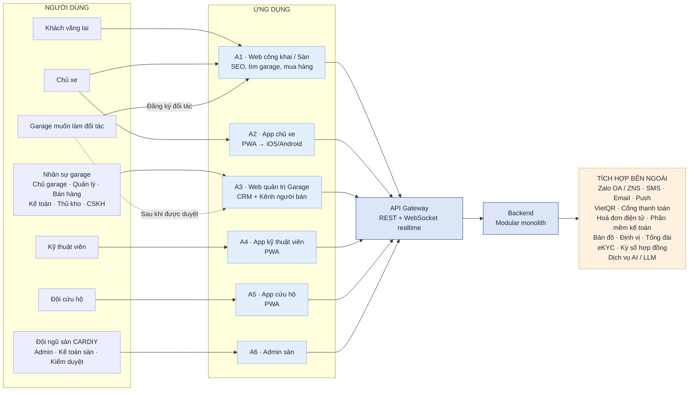
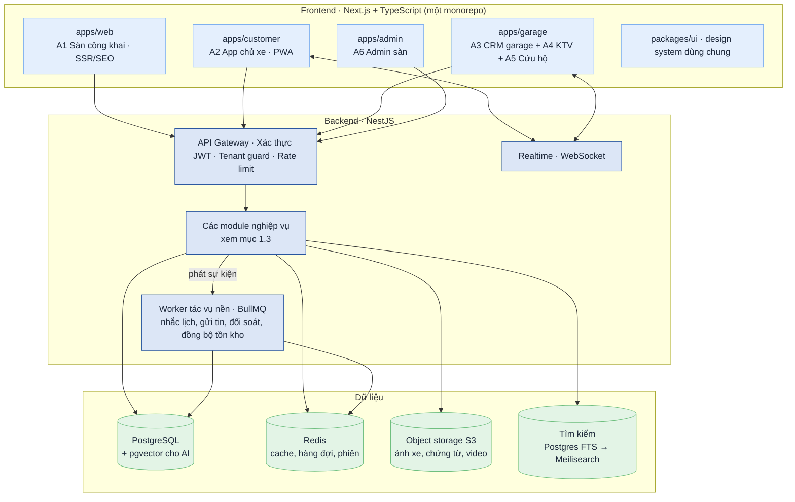
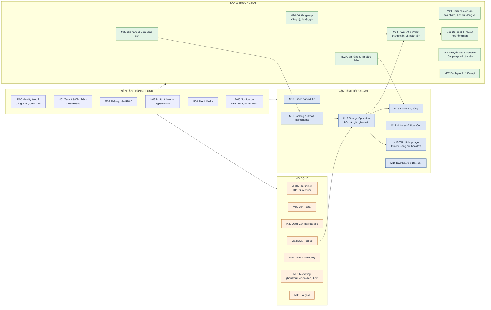

# 01 · Tổng quan hệ thống CARDIY

> Nền tảng gồm **2 phía**: (1) CRM vận hành cho garage (garage PLG và các garage đối tác dùng chung, mỗi garage là một *tenant*), (2) Sàn & app cho chủ xe. Garage đối tác tự đăng ký, được duyệt, rồi đăng bán **sản phẩm** và **dịch vụ** trên sàn.

## 1.1 Sơ đồ ngữ cảnh: ai dùng ứng dụng nào

## 1.2 Kiến trúc container

## 1.3 Bản đồ module backend

## 1.4 Nguyên tắc bắt buộc (áp dụng cho mọi module)

| # | Nguyên tắc | Cách làm |
|---|---|---|
| 1 | **Multi-tenant** | Mọi bảng nghiệp vụ có `tenant_id` (garage) và `branch_id` khi cần. Dùng Postgres Row-Level Security cùng tenant guard ở API. Garage PLG cũng là một tenant. |
| 2 | **Phân quyền RBAC** | Quyền dạng `module.action` (ví dụ `ro.approve`). Vai trò là tập quyền, gán theo phạm vi: sàn / tenant / chi nhánh / bản thân. |
| 3 | **API-first** | Mọi ứng dụng dùng chung REST API (OpenAPI) và WebSocket. Không có logic nghiệp vụ ở frontend. |
| 4 | **Realtime** | Đổi trạng thái RO, đơn hàng, SOS được đẩy qua WebSocket tới app chủ xe và CRM. |
| 5 | **Nhật ký thao tác** | Bảng `audit_log` chỉ cho thêm, không sửa hay xoá, kể cả quản trị: ai, lúc nào, giá trị cũ → mới. |
| 6 | **Sự kiện** | Mỗi thay đổi trạng thái sinh `domain_event`. Notification, đối soát và AI đều nghe sự kiện, không gọi chéo trực tiếp. |
| 7 | **Tiền** | Lưu dạng số nguyên VND (`bigint`). Mọi giao dịch đi qua sổ cái kép (`ledger_entry`). |
| 8 | **Dữ liệu cá nhân** | Lưu sự đồng ý nhận tin (`consent`). Chủ xe có quyền xuất hoặc xoá dữ liệu. Thông tin cá nhân được che trước khi gửi tới AI. |
