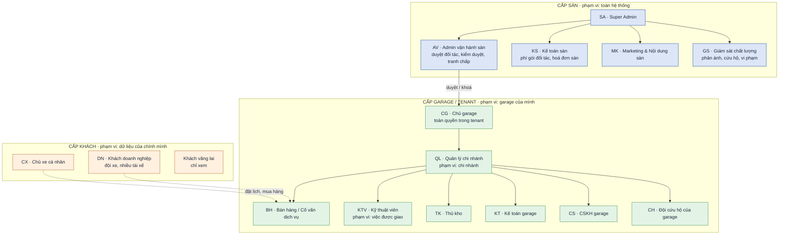

# 02 · Vai trò & phân quyền

## 2.1 Ba cấp người dùng và phạm vi dữ liệu

**Quy tắc:**
- Một người có thể giữ **nhiều vai trò** và làm ở **nhiều chi nhánh**. Ví dụ: Quản lý kiêm Bán hàng.
- Một tài khoản chủ xe có thể đồng thời là nhân sự garage. Hai vai trò dùng chung đăng nhập, tách theo "không gian làm việc".
- Chủ garage tự tạo **vai trò tuỳ chỉnh** từ danh sách quyền có sẵn.

## 2.2 Ma trận quyền

Ký hiệu: **Q** toàn quyền · **T** tạo/sửa · **D** duyệt · **X** chỉ xem · **R** của mình · **—** không có quyền.

| Module | SA | AV | KS | CG | QL | BH | KTV | TK | KT | CS | CH | CX |
|---|---|---|---|---|---|---|---|---|---|---|---|---|
| Dashboard garage | X | X | X | Q | X (CN) | X (bán hàng) | — | X (kho) | X (tài chính) | X (CSKH) | — | — |
| Khách hàng & Xe | X | X | — | Q | T | T | X (xe được giao) | — | X | T | X | R |
| Booking / Lịch hẹn | X | X | — | Q | T | T | X | — | — | T | — | R (tạo, huỷ) |
| Lệnh sửa chữa (RO) | X | X | — | Q | T + D | T | T (tiến độ, ảnh, checklist) | X | X | X | — | R (theo dõi) |
| Báo giá | X | X | — | Q | D (vượt ngưỡng) | T | Đề xuất phát sinh | — | X | — | — | D (duyệt online) |
| Kho & Phụ tùng | X | — | — | Q | X | X (tồn) | Yêu cầu xuất | Q | X | — | — | — |
| Nhập hàng / NCC | X | — | — | Q | D | — | — | T | X | — | — | — |
| Thu chi & Công nợ | X | — | X | Q | X | Thu tiền tại quầy | — | — | Q | — | — | R (hoá đơn) |
| Hoá đơn điện tử | X | — | X | Q | — | — | — | — | Q | — | — | R |
| Nhân sự & Hoa hồng | X | — | — | Q | T (CN) | R | R | R | T | R | R | — |
| Gian hàng trên sàn | Q | D | — | Q | T | T | — | T (tồn kho) | X | — | — | X |
| Yêu cầu đặt hàng từ sàn | X | X + phản ánh | — | Q | T | T | — | T (xuất kho) | X | T | — | R (gửi, huỷ) |
| Khuyến mại garage | X | X | — | Q | T | — | — | — | X | — | — | Dùng |
| Chương trình chung của sàn (garage tự tài trợ) | Q | T | — | Tham gia | — | — | — | — | — | — | — | Dùng |
| Phí đối tác & Hoá đơn sàn | Q | X | Q | R (xem, thanh toán) | — | — | — | — | R | — | — | — |
| Đánh giá | Q | Kiểm duyệt | — | Phản hồi | Phản hồi | — | — | — | — | Phản hồi | — | T (sau dịch vụ) |
| SOS Cứu hộ | X | X (giám sát) | — | Q | T | — | — | — | — | T | T (nhận ca) | T (gửi SOS) |
| Thuê xe | X | Kiểm duyệt tin | — | Q | T | T | — | — | X | T | — | T (thuê) |
| Xe cũ | Q | Kiểm duyệt | — | T (đăng, kiểm định) | T | T | Kiểm định | — | — | — | — | T (đăng bán) |
| Cộng đồng | Q | Kiểm duyệt | — | T | — | — | — | — | — | — | — | T |
| Marketing | Q | X | — | Q | T | — | — | — | — | T | — | Nhận tin (có đồng ý) |
| Trợ lý AI | Q | X | X | Q | X | X | X | X | X | X | — | Chatbot |
| Đối tác & Gói dịch vụ | Q | D | X | R (gói của mình) | — | — | — | — | — | — | — | — |
| Danh mục chuẩn | Q | T | — | Đề xuất mới | — | — | — | — | — | — | — | — |
| Cài đặt garage | X | — | — | Q | T (CN) | — | — | — | T (thuế) | — | — | — |
| Cấu hình sàn | Q | X | T (phí) | — | — | — | — | — | — | — | — | — |
| Nhật ký thao tác | X | X | X | X (tenant) | X (CN) | — | — | — | — | — | — | — |

## 2.3 Ngưỡng duyệt (cấu hình được theo tenant)

| Hành động | Ai tạo | Ai duyệt | Mặc định |
|---|---|---|---|
| Giảm giá trên RO | BH | QL nếu > 10% · CG nếu > 20% | 10% / 20% |
| Huỷ RO đã có thanh toán | QL | CG | Luôn cần duyệt |
| Điều chỉnh tồn kho (kiểm kê lệch) | TK | QL | Luôn cần duyệt |
| Chi tiền > ngưỡng | KT | CG | 5.000.000 đ |
| Hoàn tiền cho khách (garage tự hoàn) | QL | CG | Luôn cần duyệt |
