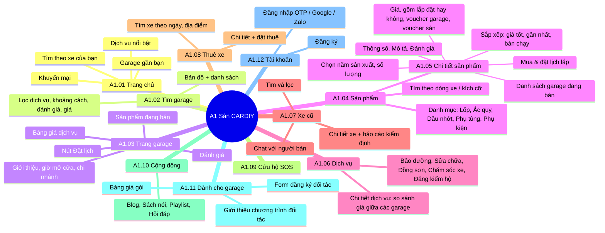
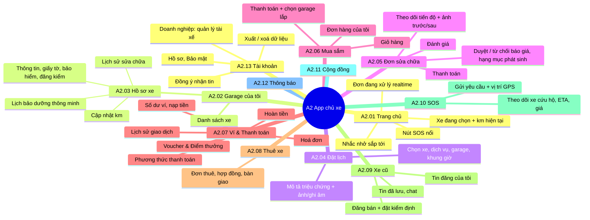
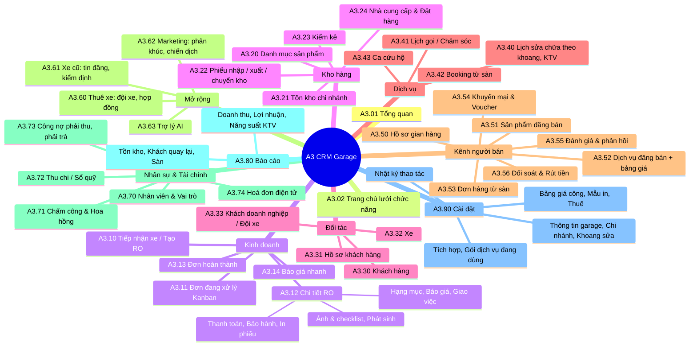
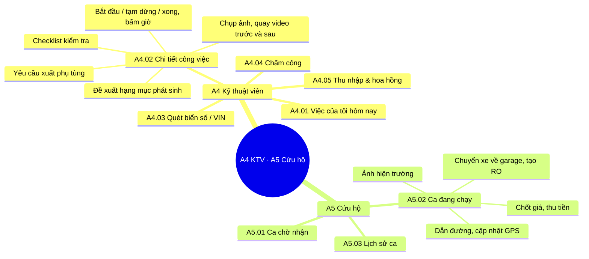
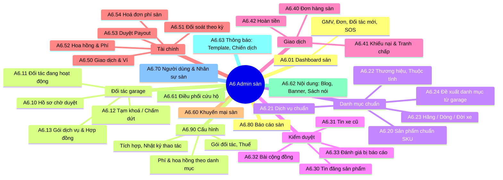

# 03 · Sơ đồ màn hình (sitemap) từng ứng dụng

> Mỗi nút lá là **một màn hình hoặc một tab**. Mã màn hình (ví dụ `A3.12`) dùng xuyên suốt khi giao việc cho AI và khi kiểm thử.

## A1 · Web công khai / Sàn (SEO, không cần đăng nhập để xem)

## A2 · App chủ xe (PWA, sau làm app iOS/Android)

## A3 · Web quản trị Garage (CRM + Kênh người bán)

## A4 · App kỹ thuật viên & A5 · App cứu hộ (PWA, tối ưu điện thoại)

## A6 · Admin sàn

