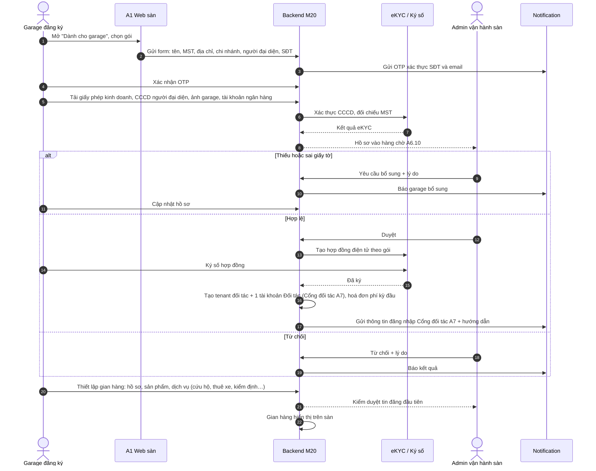
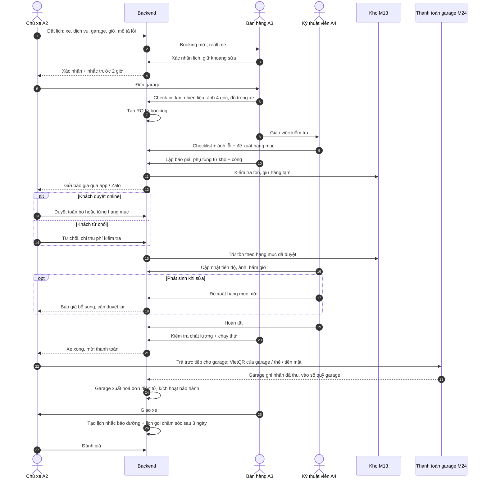
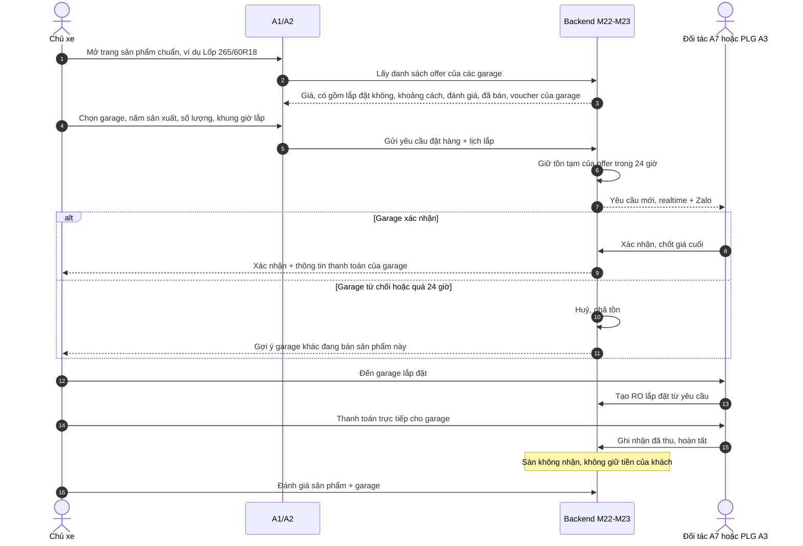
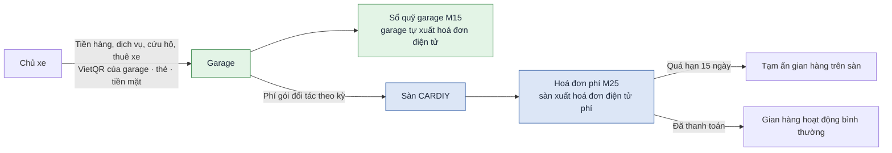
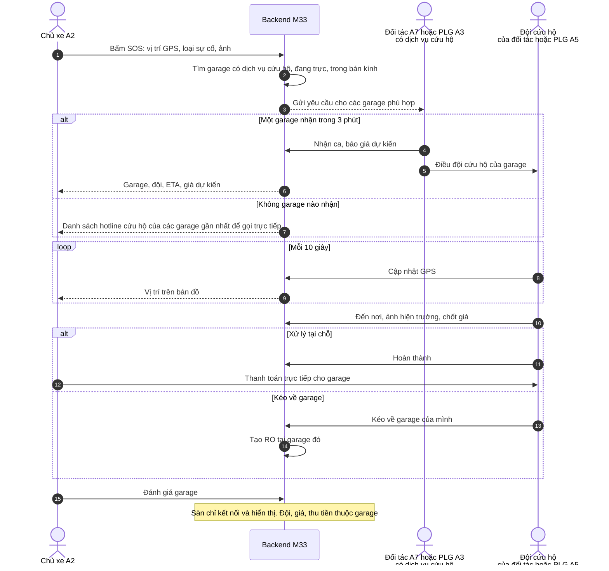
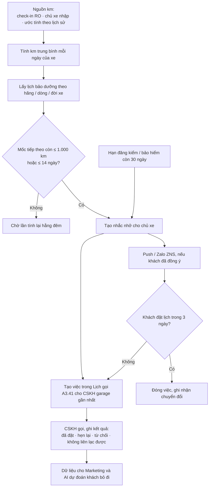
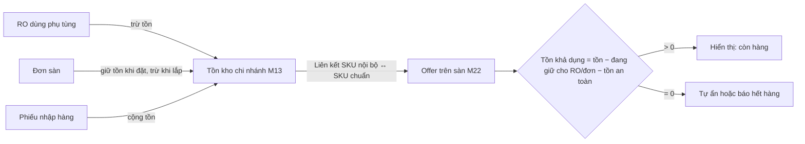
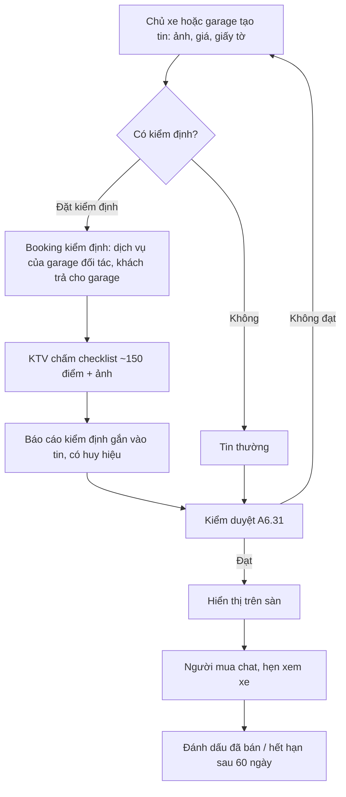
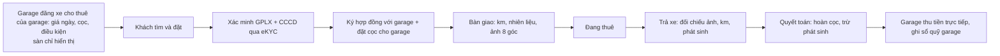

# 04 · Luồng nghiệp vụ

## F1 · Garage đăng ký làm đối tác

> **Đã làm ở vòng 3.1 (bản rút gọn):** form công khai `/dang-ky-doi-tac` → người nộp nhận link theo dõi (mã hồ sơ + mã bí mật) để tải giấy tờ, sửa hồ sơ khi được yêu cầu bổ sung → Admin sàn duyệt ở A6.10 → hệ thống tạo tenant đối tác (Đang thiết lập), tài khoản Đối tác bằng SĐT đăng ký (mật khẩu tạm, Sàn gửi tay), gói và hoá đơn phí kỳ đầu (hạn 7 ngày) → Kế toán sàn ghi nhận đã thu ở A6.50 → đối tác chuyển Hoạt động. **Chưa làm:** OTP xác thực SĐT/email khi nộp, eKYC CCCD, đối chiếu MST tự động, hợp đồng ký số, tự gửi thông tin đăng nhập (Zalo/SMS). Sơ đồ dưới là luồng đầy đủ dự kiến.

## F2 · Đặt lịch → Lệnh sửa chữa → Báo giá → Thanh toán

## F3 · Đặt sản phẩm trên sàn + lắp tại garage

Theo mẫu trang lốp: một sản phẩm chuẩn có nhiều garage cùng bán. **Sàn chỉ chuyển yêu cầu, khách trả tiền trực tiếp cho garage.**

## F4 · Dòng tiền

> Tiền của khách **không bao giờ** đi qua sàn. Hoàn tiền, đổi trả và bảo hành do garage xử lý theo chính sách garage công bố trên gian hàng. Sàn tiếp nhận **phản ánh**, yêu cầu garage giải trình, và có thể ẩn hoặc khoá gian hàng vi phạm.

## F5 · Cứu hộ SOS: sàn kết nối, garage thực hiện

## F6 · Bảo dưỡng thông minh & Lịch gọi

## F7 · Đồng bộ tồn kho với tin đăng trên sàn (chỉ PLG)

> Đối tác không có CRM: nhập **số lượng tồn trực tiếp trên tin đăng** ở Cổng đối tác. Luồng dưới chỉ áp dụng cho sản phẩm PLG bán trên sàn.

## F8 · Đăng bán xe cũ

> **Đã làm (vòng 4.3):** Chủ xe trên App chủ xe (`A2.09`) hoặc garage PLG / Đối tác (`A3.61`, `A7.23`) tạo tin bán xe cũ (`XC…`, kèm ảnh giấy tờ riêng tư chỉ người bán – garage kiểm định – kiểm duyệt sàn xem được). Chủ xe có thể đặt lịch kiểm định tại bất kỳ garage đang bật dịch vụ kiểm định (hoặc garage tự lập phiếu kiểm định cho xe mình bán); KTV / garage chấm checklist 6 nhóm kỹ thuật (100 điểm), chụp ảnh báo cáo và thu phí trực tiếp tại garage → báo cáo gắn vào tin (huy hiệu **Đã kiểm định** khi đạt chuẩn). Mọi tin gửi duyệt qua Kiểm duyệt `A6.31` trước khi hiển thị công khai trên `/cho/xe-cu` (`A1.07`); tự động hết hạn sau 60 ngày (`expires_at`), người mua gửi tin nhắn chat & đặt lịch hẹn xem xe trực tiếp với người bán.

## F9 · Thuê xe

