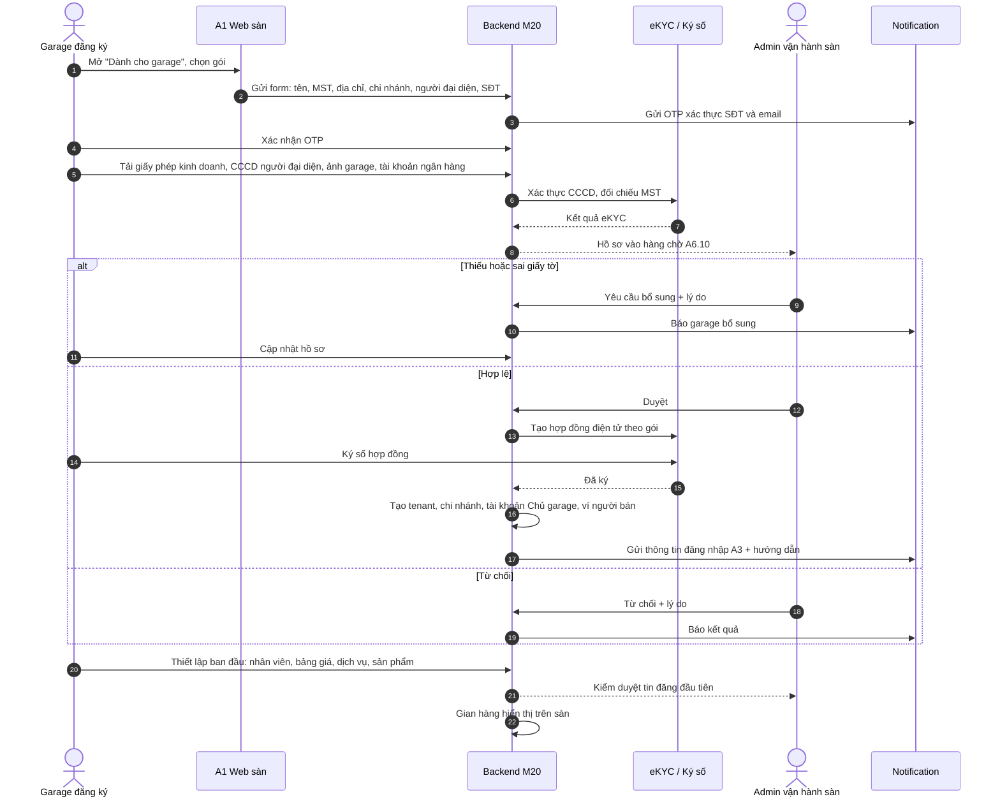
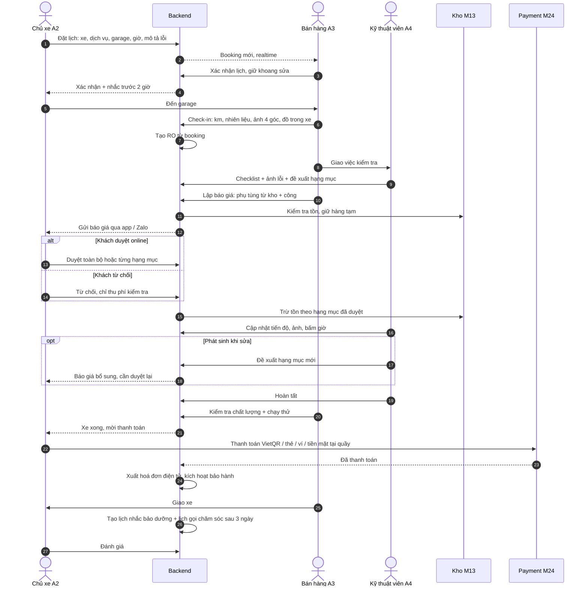
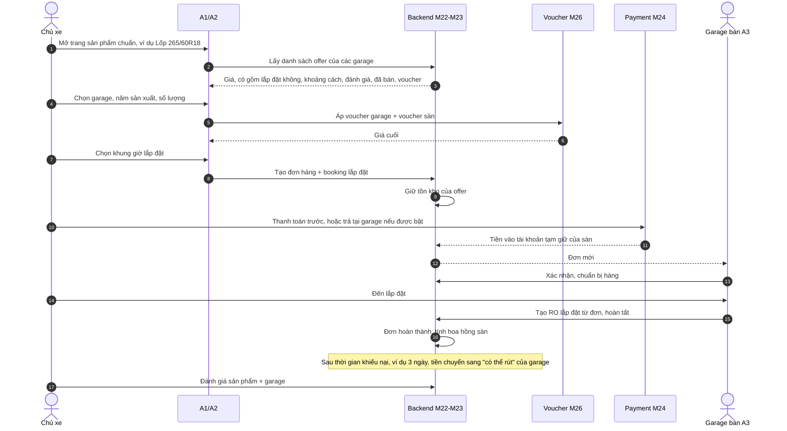
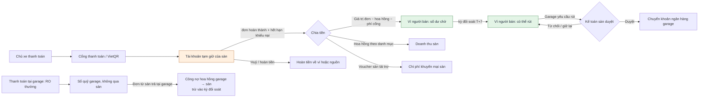
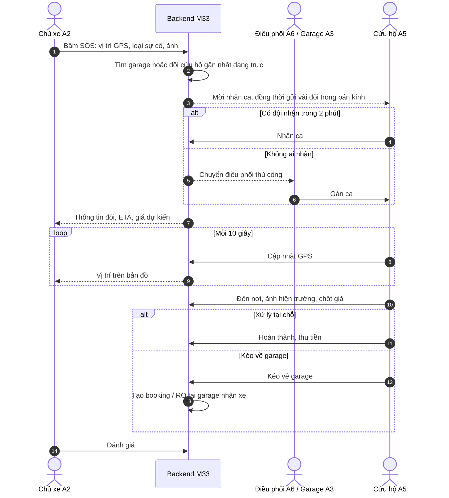
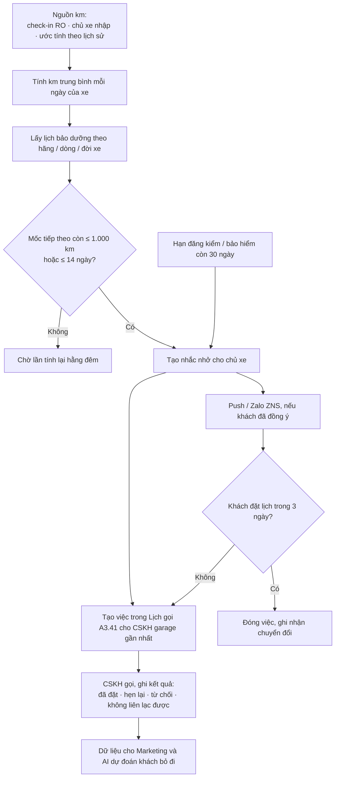
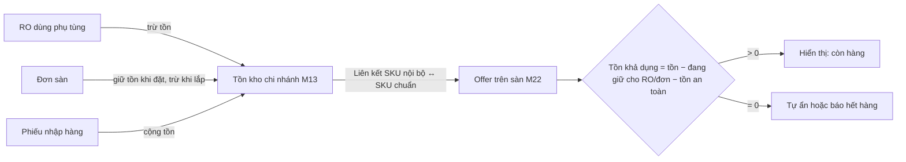
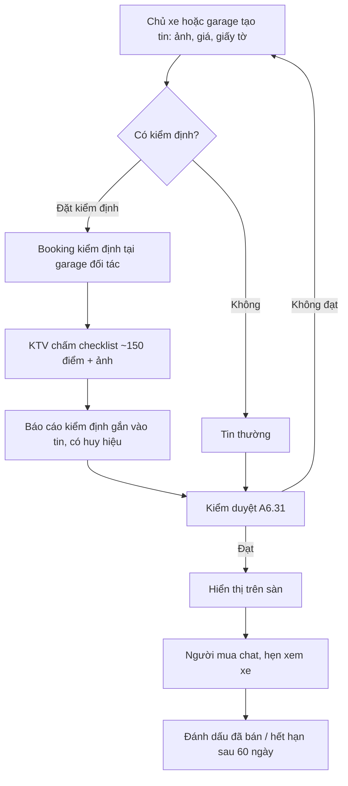

# 04 · Luồng nghiệp vụ

## F1 · Garage đăng ký làm đối tác

## F2 · Đặt lịch → Lệnh sửa chữa → Báo giá → Thanh toán

## F3 · Mua sản phẩm trên sàn + lắp tại garage

Theo mẫu trang lốp: một sản phẩm chuẩn có nhiều garage cùng bán.

## F4 · Dòng tiền: thanh toán, tạm giữ, đối soát, chi trả

## F5 · Cứu hộ SOS

## F6 · Bảo dưỡng thông minh & Lịch gọi

## F7 · Đồng bộ tồn kho với tin đăng trên sàn

## F8 · Đăng bán xe cũ

## F9 · Thuê xe

```mermaid
flowchart LR
  A["Garage đăng xe cho thuê: giá ngày, cọc, điều kiện"] --> B["Khách tìm và đặt"]
  B --> C["Xác minh GPLX + CCCD qua eKYC"]
  C --> D["Ký hợp đồng điện tử + đặt cọc"]
  D --> E["Bàn giao: km, nhiên liệu, ảnh 8 góc"]
  E --> F["Đang thuê"]
  F --> G["Trả xe: đối chiếu ảnh, km, phát sinh"]
  G --> H["Quyết toán: hoàn cọc, trừ phát sinh"]
  H --> I["Chia doanh thu: garage, chủ xe ký gửi, sàn"]
```

