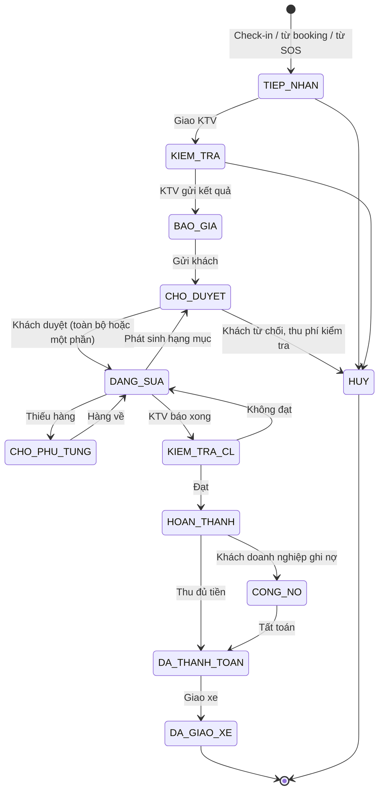
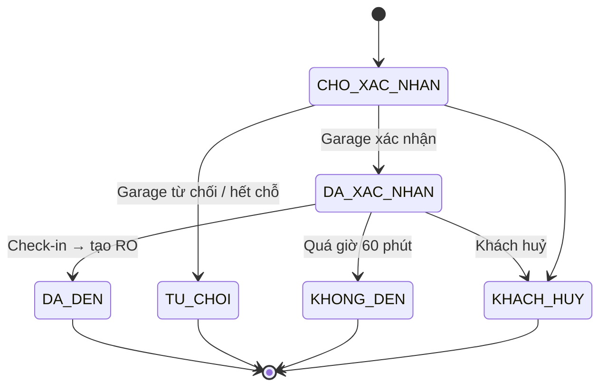
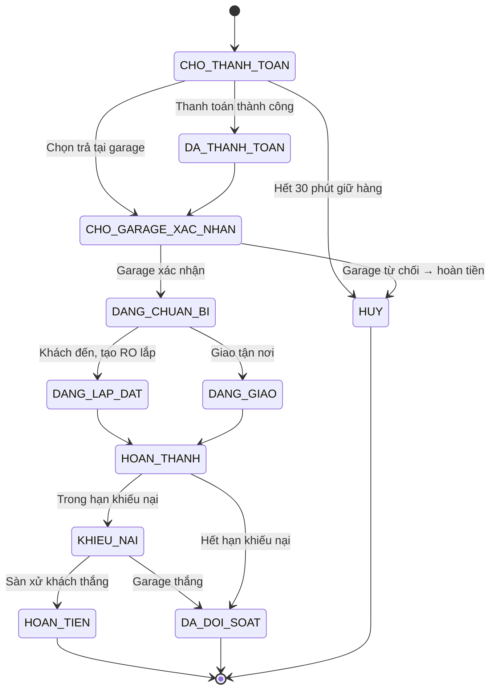
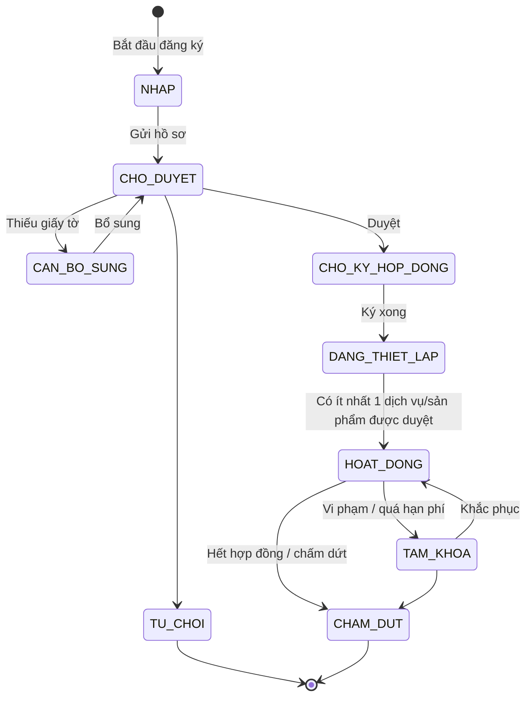
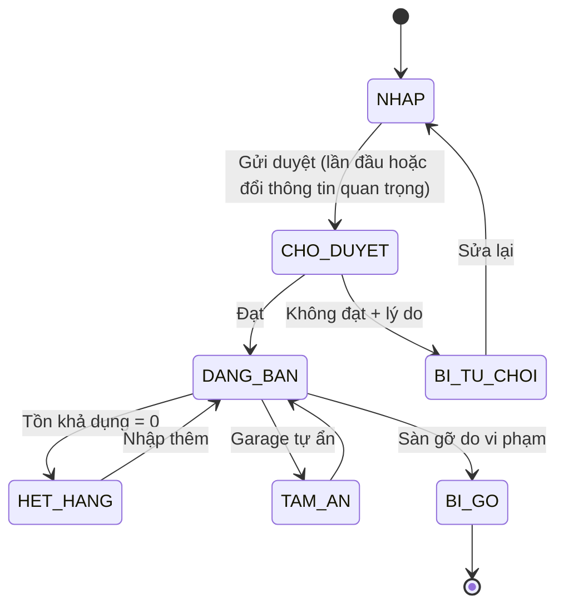
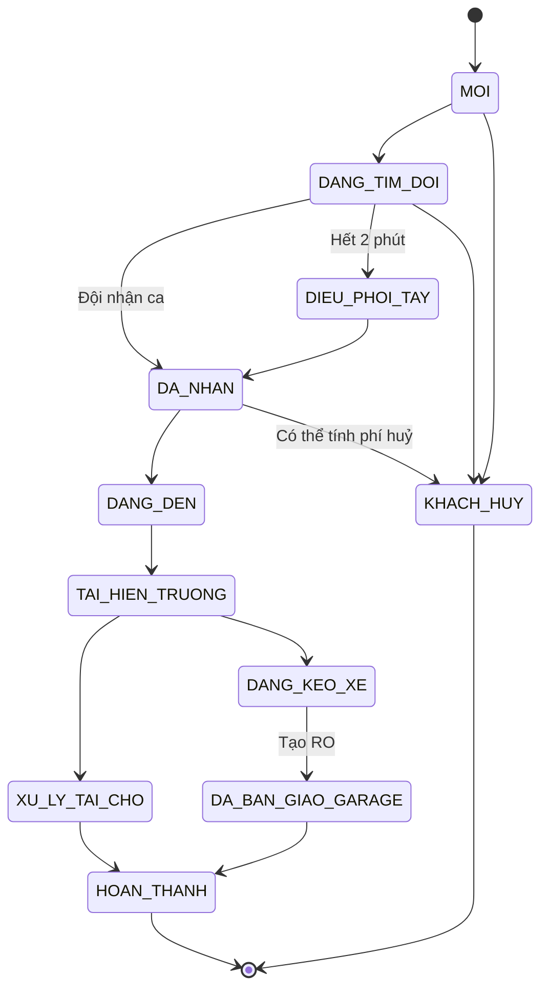
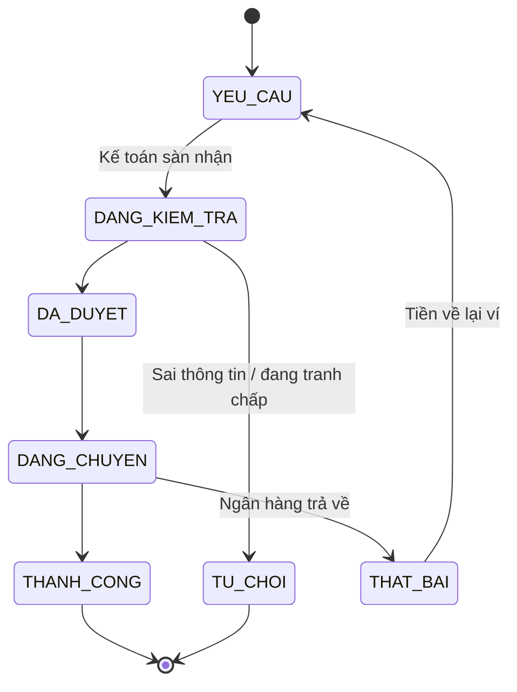
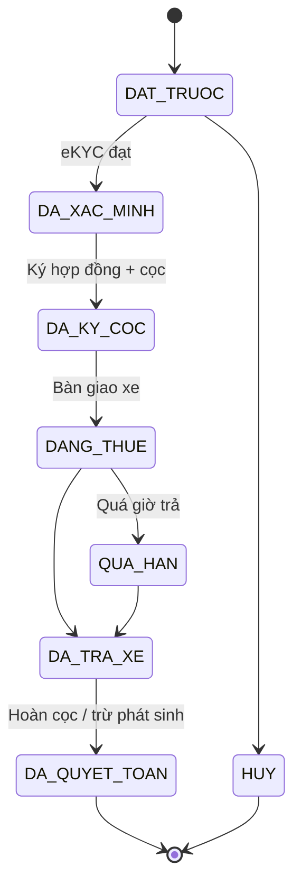

# 05 · Máy trạng thái

> Mỗi lần chuyển trạng thái phải: kiểm tra quyền, ghi `audit_log`, phát `domain_event`. Chuyển trạng thái **chỉ** theo đúng mũi tên trong sơ đồ; mọi chuyển khác đều bị API từ chối.

## S1 · Lệnh sửa chữa (RO)

## S2 · Booking

## S3 · Đơn hàng sàn

## S4 · Đối tác garage (tenant)

## S5 · Tin đăng sản phẩm / dịch vụ của garage (offer)

## S6 · Ca cứu hộ SOS

## S7 · Yêu cầu rút tiền (payout)

## S8 · Hợp đồng thuê xe

