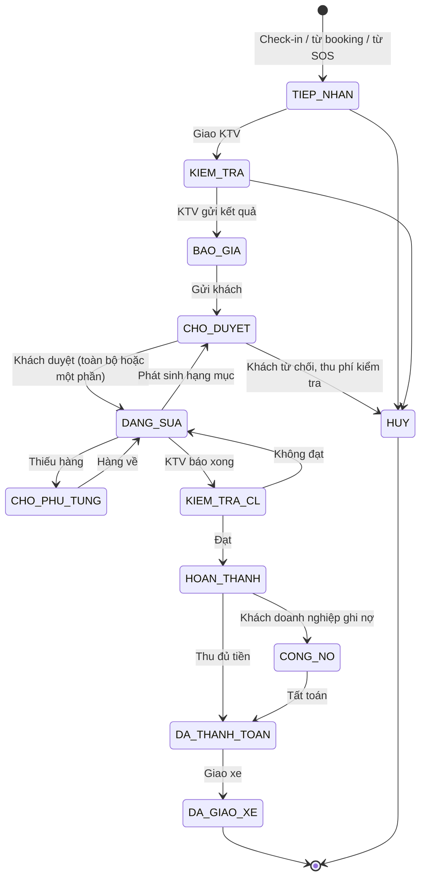
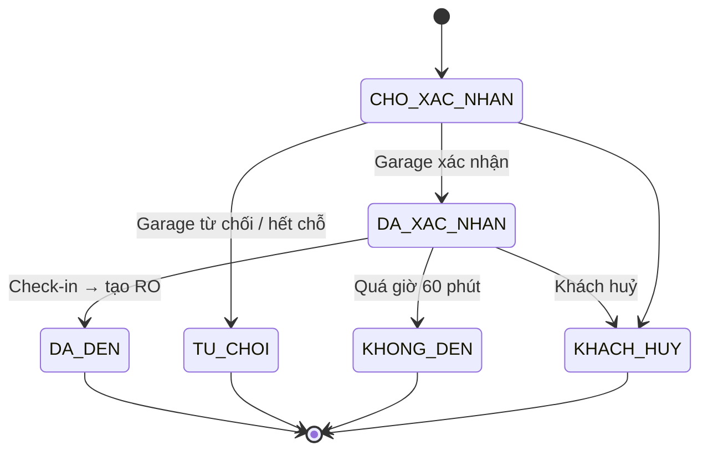
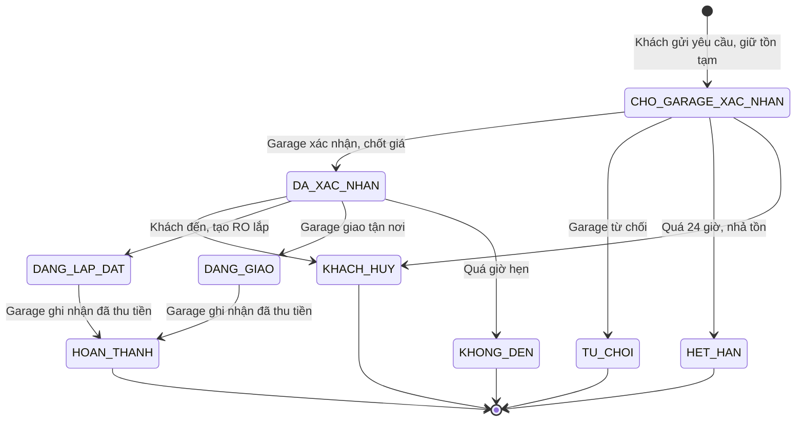
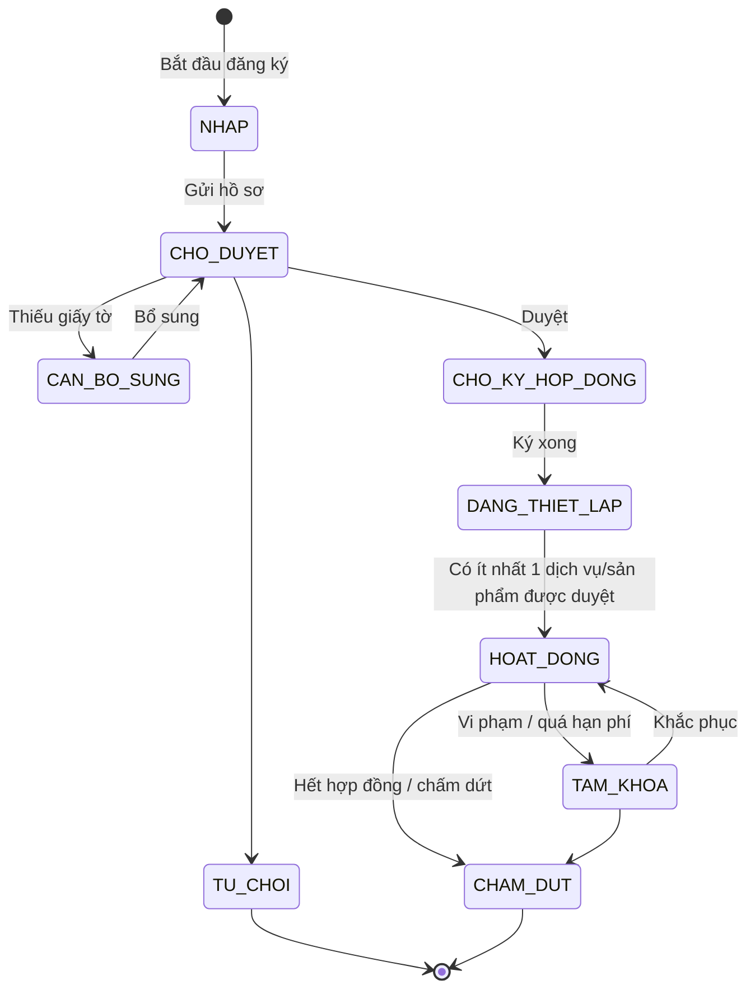
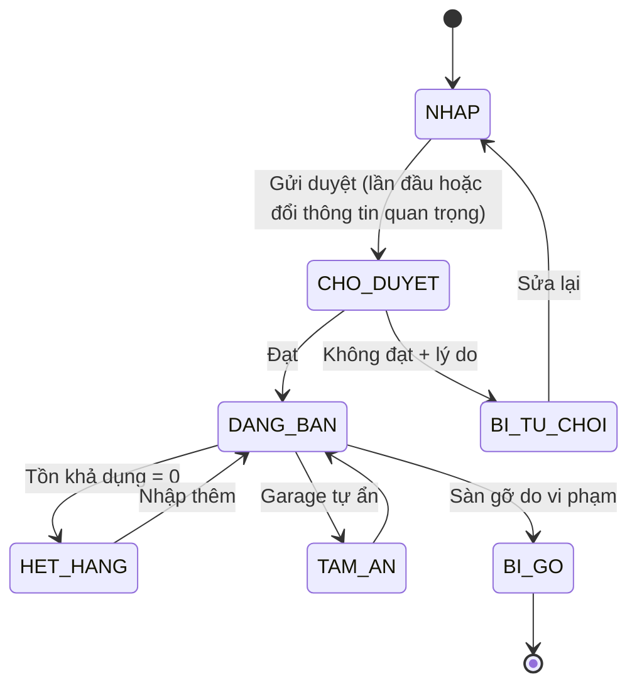
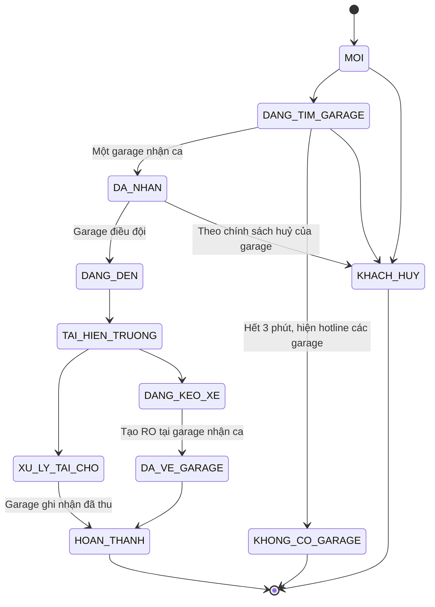
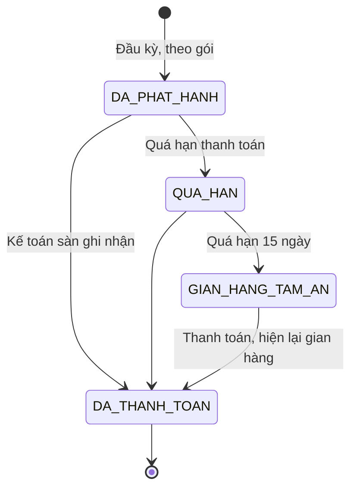
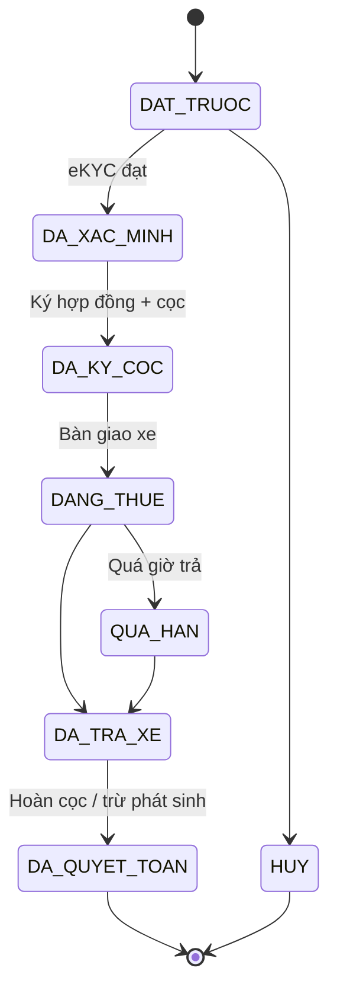

# 05 · Máy trạng thái

> Mỗi lần chuyển trạng thái phải: kiểm tra quyền, ghi `audit_log`, phát `domain_event`. Chuyển trạng thái **chỉ** theo đúng mũi tên trong sơ đồ; mọi chuyển khác đều bị API từ chối.

## S1 · Lệnh sửa chữa (RO)

## S2 · Booking

## S3 · Yêu cầu đặt hàng từ sàn

> **Đã làm (vòng 3.4), bản rút gọn:** `CHO_XAC_NHAN → DA_XAC_NHAN → HOAN_THANH`, cùng `TU_CHOI`, `HET_HAN` (24 giờ, tính khi đọc), `KHACH_HUY`, `KHONG_DEN`. Chưa tách `DANG_LAP_DAT` / `DANG_GIAO`: garage xác nhận rồi bấm Hoàn tất khi khách đã đến lắp / nhận và đã trả tiền. PLG chưa tự tạo lệnh sửa chữa từ yêu cầu (nhân viên lập đơn trong CRM như thường).

> Không có trạng thái thanh toán, hoàn tiền hay đối soát vì tiền không đi qua sàn. Phản ánh của khách là một đối tượng riêng (`market_reports`: `MOI → CHO_GIAI_TRINH → DA_GIAI_TRINH → DA_XU_LY | TU_CHOI`), không làm thay đổi trạng thái yêu cầu.

## S4 · Đối tác garage (tenant)

## S5 · Tin đăng sản phẩm / dịch vụ của garage (offer)

## S6 · Ca cứu hộ SOS

## S7 · Hoá đơn phí đối tác

## S8 · Hợp đồng thuê xe

