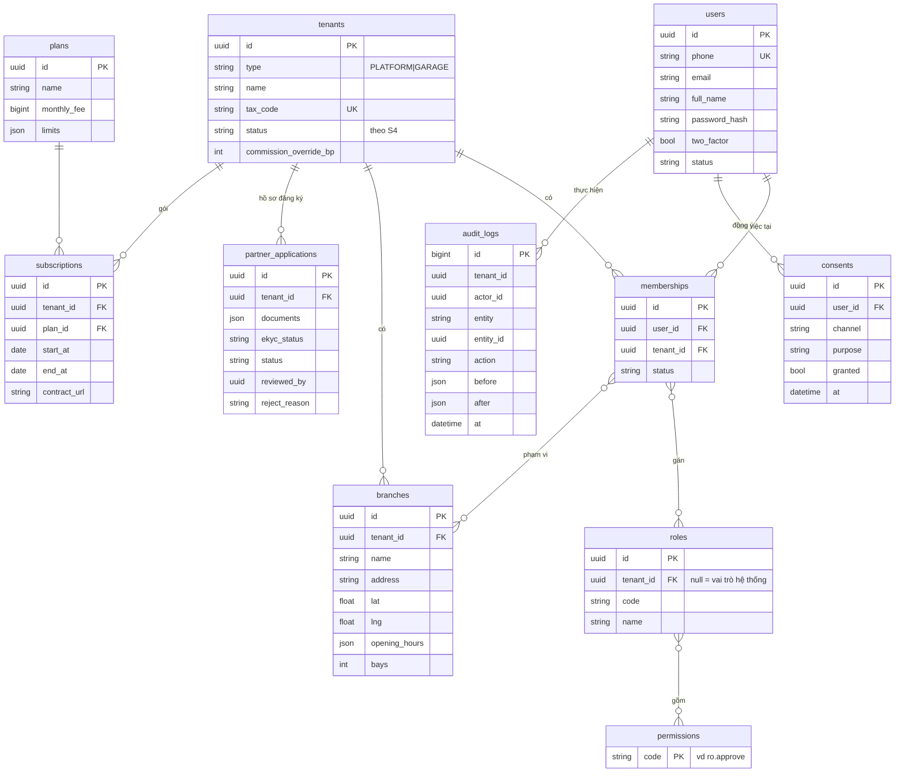
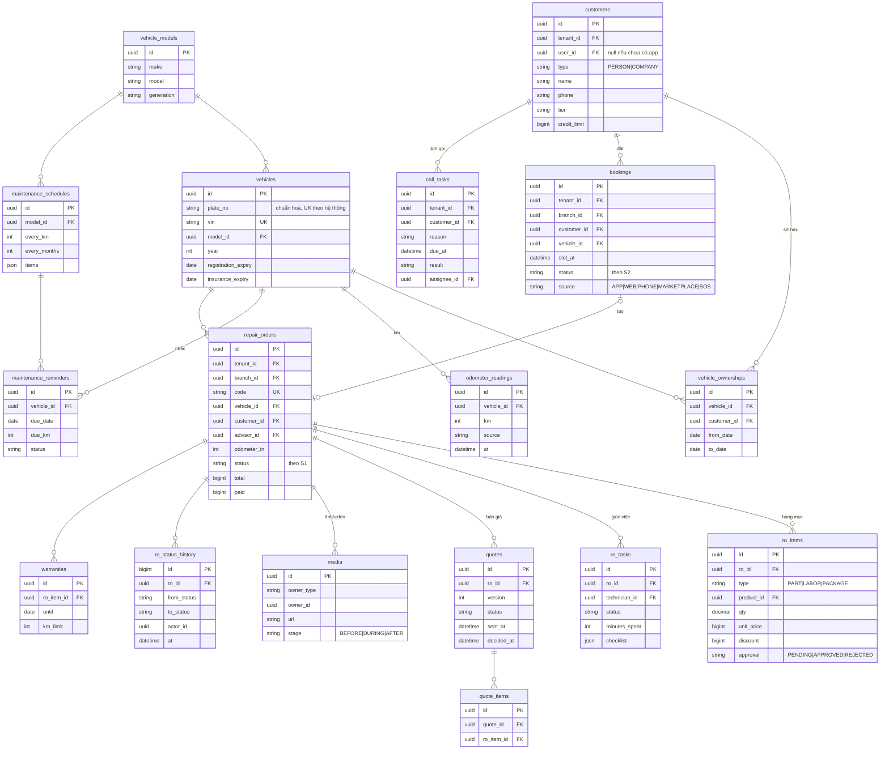
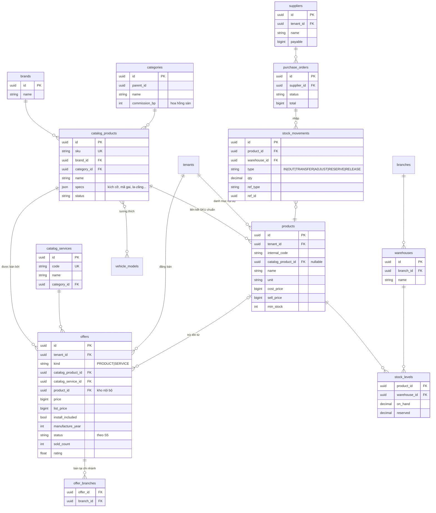
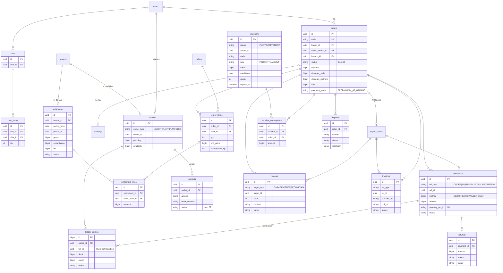
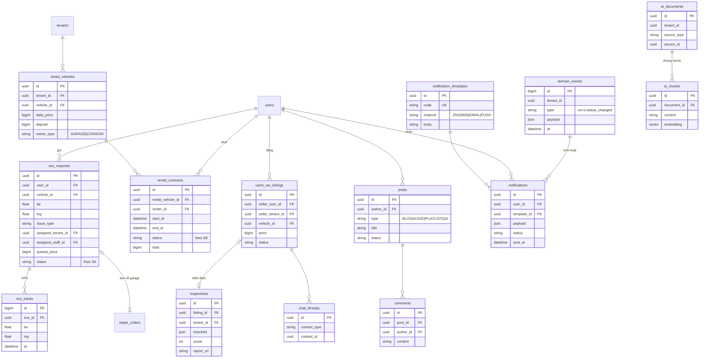

# 06 · Mô hình dữ liệu (ERD)

> Quy ước: khoá chính `id uuid`. Bảng nghiệp vụ nào cũng có `tenant_id`, `created_at`, `updated_at`, `created_by`, `deleted_at` (xoá mềm). Tiền lưu `bigint` VND. Tên bảng tiếng Anh, số nhiều, snake_case.

## D1 · Định danh, tenant, phân quyền

## D2 · Khách hàng, xe, booking, lệnh sửa chữa

## D3 · Kho, danh mục chuẩn, gian hàng trên sàn

## D4 · Đơn hàng sàn, thanh toán, ví, đối soát, khuyến mại

## D5 · Mở rộng: cứu hộ, thuê xe, xe cũ, cộng đồng, thông báo, AI

