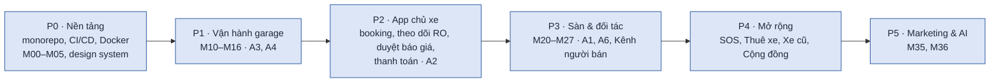

# 07 · Kế hoạch xây dựng & cách giao cho AI

## 7.1 Thứ tự xây dựng

Mỗi pha chỉ bắt đầu khi pha trước đạt tiêu chí nghiệm thu.

| Pha | Phạm vi | Nghiệm thu tối thiểu |
|---|---|---|
| P0 | Monorepo (Turborepo), Next.js, NestJS, Postgres + Prisma, Redis, Docker Compose, GitHub Actions; đăng nhập OTP, tenant, RBAC, audit log, upload file, khung thông báo; design system theo `crm-prototype/index.html` | Tạo tenant, user, vai trò; đăng nhập; mỗi request kiểm tra tenant + quyền; test tự động chạy trên CI |
| P1 | Khách hàng, Xe, RO đủ máy trạng thái S1, báo giá, kho (nhập/xuất/chuyển/kiểm kê), thu chi, công nợ, hoá đơn điện tử, lịch hẹn, lịch gọi, dashboard; app KTV | Chạy trọn luồng F2 tại quầy (chưa cần app khách); số tồn kho và sổ quỹ khớp sau 100 RO thử |
| P2 | App chủ xe: tài khoản, xe, đặt lịch, theo dõi realtime, duyệt báo giá, thanh toán VietQR, đánh giá, nhắc bảo dưỡng F6 | Khách duyệt báo giá trên điện thoại và RO cập nhật ngay trong CRM |
| P3 | Đăng ký đối tác F1, gói & hoá đơn phí S7, danh mục chuẩn, offer, đồng bộ tồn F7, yêu cầu đặt hàng S3, voucher của garage, phản ánh & xử lý vi phạm; trang sản phẩm theo mẫu | Một garage mới tự đăng ký → được duyệt → đăng bán → khách gửi yêu cầu → garage xác nhận, lắp, tự thu tiền; sàn phát hành và ghi nhận hoá đơn phí của garage |
| P4 | SOS F5, Thuê xe F9, Xe cũ F8, Cộng đồng, Multi-garage KPI | Mỗi luồng chạy trọn từ đầu đến cuối với dữ liệu thật |
| P5 | Phân khúc, chiến dịch, điểm thưởng; trợ lý AI tóm tắt lịch sử xe, gợi ý báo giá, chatbot đặt lịch | Chiến dịch gửi đúng tập khách đã đồng ý; AI chỉ đề xuất, người duyệt mới ghi |

## 7.2 Cách giao việc cho AI lập trình

1. **Giao cả thư mục `crm-spec/`** và file thiết kế `crm-prototype/index.html`. Yêu cầu AI đọc hết trước khi viết code.
2. **Giao theo pha và theo module.** Ví dụ: *"Làm P1 · module M12 Garage Operation: bảng theo D2, máy trạng thái S1, màn hình A3.10–A3.14 và A4.01–A4.02, quyền theo ma trận 02"*.
3. **Mỗi module bàn giao đủ 5 thứ:**
   - migration DB
   - API kèm OpenAPI
   - màn hình
   - test (đơn vị + luồng đầu cuối theo sơ đồ F tương ứng)
   - seed dữ liệu mẫu
4. **Sơ đồ là luật.** Mọi chuyển trạng thái ngoài sơ đồ S1–S8 phải bị API từ chối và có test cho việc đó.
5. **Khi đổi nghiệp vụ, sửa sơ đồ trước, code sau,** để tài liệu luôn đúng với hệ thống.

> **Lưu ý thực tế:** hệ thống này tương đương nhiều tháng công. Bộ sơ đồ giúp AI làm **đúng và nhất quán qua từng pha**, nhưng không nên kỳ vọng sinh toàn bộ trong một lần chạy. Làm như vậy rất khó kiểm thử và hầu như chắc chắn có lỗi ở tiền, tồn kho và phân quyền.

## 7.3 Mô hình kinh doanh đã chốt

| Chủ đề | Quyết định |
|---|---|
| Vai trò của sàn | **Trung gian hiển thị và kết nối**: hiển thị garage, sản phẩm, dịch vụ; chuyển yêu cầu; thu thập đánh giá; xử lý phản ánh |
| Tiền của khách | Trả **trực tiếp cho garage**. Sàn không thu hộ, không giữ tiền, không có ví, không đối soát, không chi trả |
| Doanh thu của sàn | **Phí gói đối tác** theo kỳ. Garage chuyển khoản, kế toán sàn ghi nhận và xuất hoá đơn |
| Hoàn tiền, đổi trả, bảo hành | Garage tự xử lý theo chính sách công bố trên gian hàng |
| Cứu hộ, thuê xe, kiểm định | Là **dịch vụ của garage**. Sàn chuyển yêu cầu SOS tới garage gần nhất có dịch vụ cứu hộ |
| Voucher | Garage phát hành và chịu chi phí. Sàn có thể mở chương trình chung để garage tham gia |

## 7.4 Câu hỏi còn cần chốt

| # | Câu hỏi | Ảnh hưởng tới |
|---|---|---|
| 1 | Bảng giá các gói đối tác: số gói, giá mỗi kỳ, giới hạn (số chi nhánh, số tin đăng, số người dùng) | M20, M25, bảng `plans` |
| 2 | Garage chỉ dùng sàn (không dùng CRM) có được không, hay gói nào cũng kèm CRM? | Phân quyền, gói |
| 3 | Thời gian garage phải xác nhận yêu cầu (đề xuất 24 giờ) và nhận ca SOS (đề xuất 3 phút) | S3, S6 |
| 4 | Ai tạo danh mục sản phẩm chuẩn: sàn tự nhập hay garage đề xuất? | M21, A6.24 |
| 5 | Thủ tục pháp lý: đăng ký website cung cấp dịch vụ TMĐT với Bộ Công Thương (sàn vẫn cần đăng ký dù không thu hộ tiền) | Ra mắt A1 |
