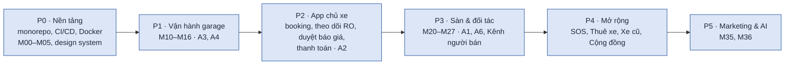

# 07 · Kế hoạch xây dựng & cách giao cho AI

## 7.1 Thứ tự xây dựng

Mỗi pha chỉ bắt đầu khi pha trước đạt tiêu chí nghiệm thu.

| Pha | Phạm vi | Nghiệm thu tối thiểu |
|---|---|---|
| P0 | Monorepo (Turborepo), Next.js, NestJS, Postgres + Prisma, Redis, Docker Compose, GitHub Actions; đăng nhập OTP, tenant, RBAC, audit log, upload file, khung thông báo; design system theo `crm-prototype/index.html` | Tạo tenant, user, vai trò; đăng nhập; mỗi request kiểm tra tenant + quyền; test tự động chạy trên CI |
| P1 | Khách hàng, Xe, RO đủ máy trạng thái S1, báo giá, kho (nhập/xuất/chuyển/kiểm kê), thu chi, công nợ, hoá đơn điện tử, lịch hẹn, lịch gọi, dashboard; app KTV | Chạy trọn luồng F2 tại quầy (chưa cần app khách); số tồn kho và sổ quỹ khớp sau 100 RO thử |
| P2 | App chủ xe: tài khoản, xe, đặt lịch, theo dõi realtime, duyệt báo giá, thanh toán VietQR, đánh giá, nhắc bảo dưỡng F6 | Khách duyệt báo giá trên điện thoại và RO cập nhật ngay trong CRM |
| P3 | Đăng ký đối tác F1, danh mục chuẩn, offer, đồng bộ tồn F7, giỏ hàng, đơn sàn S3, voucher 2 cấp, ví + sổ cái, đối soát, payout F4, khiếu nại; trang sản phẩm theo mẫu | Một garage mới tự đăng ký → được duyệt → đăng bán → khách mua → lắp → tiền về ví sau đối soát; sổ cái cân bằng |
| P4 | SOS F5, Thuê xe F9, Xe cũ F8, Cộng đồng, Multi-garage KPI | Mỗi luồng chạy trọn từ đầu đến cuối với dữ liệu thật |
| P5 | Phân khúc, chiến dịch, điểm thưởng; trợ lý AI tóm tắt lịch sử xe, gợi ý báo giá, chatbot đặt lịch | Chiến dịch gửi đúng tập khách đã đồng ý; AI chỉ đề xuất, người duyệt mới ghi |

## 7.2 Cách giao việc cho AI lập trình

1. **Giao cả thư mục `crm-spec/`** và file thiết kế `crm-prototype/index.html`. Yêu cầu AI đọc hết trước khi viết code.
2. **Giao theo pha và theo module.** Ví dụ: *"Làm P1 · module M12 Garage Operation: bảng theo D2, máy trạng thái S1, màn hình A3.10–A3.14 và A4.01–A4.02, quyền theo ma trận 02"*.
3. **Mỗi module bàn giao đủ 5 thứ:**
   - migration DB
   - API kèm OpenAPI
   - màn hình
   - test (đơn vị + luồng đầu cuối theo sơ đồ F tương ứng)
   - seed dữ liệu mẫu
4. **Sơ đồ là luật.** Mọi chuyển trạng thái ngoài sơ đồ S1–S8 phải bị API từ chối và có test cho việc đó.
5. **Khi đổi nghiệp vụ, sửa sơ đồ trước, code sau,** để tài liệu luôn đúng với hệ thống.

> **Lưu ý thực tế:** hệ thống này tương đương nhiều tháng công. Bộ sơ đồ giúp AI làm **đúng và nhất quán qua từng pha**, nhưng không nên kỳ vọng sinh toàn bộ trong một lần chạy. Làm như vậy rất khó kiểm thử và hầu như chắc chắn có lỗi ở tiền, tồn kho và phân quyền.

## 7.3 Những điểm cần chủ đầu tư chốt trước P3

| # | Câu hỏi | Ảnh hưởng tới |
|---|---|---|
| 1 | Mô hình thu phí đối tác: phí tháng, hoa hồng theo đơn, hay cả hai? Tỷ lệ theo danh mục? | M20, M25, bảng `plans`, `categories.commission_bp` |
| 2 | Sàn có giữ tiền hộ (escrow) không, hay garage tự thu? Pháp nhân nào đứng tên thu? | F4, giấy phép trung gian thanh toán, chọn cổng thanh toán |
| 3 | Thời gian khiếu nại và kỳ đối soát (đề xuất 3 ngày và T+7) | S3, M25 |
| 4 | Ai tạo danh mục sản phẩm chuẩn: sàn tự nhập hay garage đề xuất? | M21, A6.24 |
| 5 | Cứu hộ dùng đội của sàn, của garage hay cả hai? Giá cố định hay theo km? | M33, F5 |
| 6 | Thuê xe có nhận ký gửi xe của cá nhân không? | M31, `rental_vehicles.owner_type` |
| 7 | Thủ tục pháp lý cho sàn TMĐT: đăng ký website cung cấp dịch vụ TMĐT với Bộ Công Thương | Ra mắt A1 |
