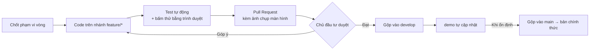

# 08 · Lộ trình xây dựng

> Đã được chủ đầu tư đồng ý ngày 19/11/2026. Mô hình: **sàn là trung gian hiển thị và kết nối**; tiền của khách trả trực tiếp cho garage; cứu hộ là dịch vụ của garage (xem 07 · mục 7.3).

## 1. Cách làm việc mỗi vòng

- **Mỗi vòng giao đủ 5 thứ:** migration, API có tài liệu OpenAPI, màn hình, test, dữ liệu mẫu.
- **Nhánh git:** `feature/*` cho việc đang làm · `develop` cho bản demo · `main` cho bản chính thức.
- Đổi nghiệp vụ thì **sửa sơ đồ trong `docs/` trước, code sau**.

## 2. Các giai đoạn

### P0 · Nền móng (4 vòng) ✅
| Vòng | Nội dung | Kết quả |
|---|---|---|
| 0.1 | Monorepo (Next.js, NestJS, PostgreSQL, Redis), Docker Compose, CI trên GitHub, design system theo bản thiết kế pastel | `pnpm dev` chạy được, khung giao diện giống bản thiết kế |
| 0.2 | Đăng nhập SĐT + mật khẩu/OTP, multi-tenant, chi nhánh, vai trò & phân quyền, nhật ký thao tác, upload ảnh | Đăng nhập theo từng vai trò thấy menu khác nhau |
| 0.3 | Triển khai VPS: Docker Compose + Caddy, sao lưu, cập nhật một lệnh | Bản demo chạy trên tên miền thật |
| 0.4 | Tách **Đối tác**: loại tài khoản riêng, 1 tài khoản / đối tác, khung **Cổng đối tác** (A7) | Đối tác đăng nhập chỉ thấy gian hàng, sản phẩm, dịch vụ, yêu cầu của khách |

### P1 · Vận hành garage (5 vòng)
| Vòng | Nội dung |
|---|---|
| 1.1 | Khách hàng, Xe, hồ sơ khách, nhập dữ liệu cũ từ Excel/Google Sheets |
| 1.2 | Lệnh sửa chữa: tiếp nhận, Kanban, chi tiết lệnh, giao việc, máy trạng thái S1 |
| 1.3 | Báo giá, in phiếu, thu tiền tại garage (tiền mặt, VietQR của garage), bảo hành |
| 1.4 | Kho: danh mục, tồn chi nhánh, nhập/xuất/chuyển kho, kiểm kê, nhà cung cấp |
| 1.4c | Nhập danh mục sản phẩm + tồn đầu kỳ từ file Excel kho AppSheet (sheet SẢN PHẨM, BANG_GIA_3CN, LO DATE); **bảng giá theo chi nhánh**: giá Bình Phước (BP, giá chính), giá Bình Dương (BD), giá VAT — chi nhánh chọn bảng giá trong Cài đặt (CN3 Mỹ Phước dùng BD) |
| 1.5 | Lịch hẹn, Lịch gọi, Thu chi & công nợ, Dashboard, App kỹ thuật viên |
| 1.5+ | **Phiếu kiểm tra xe điện tử** (theo mẫu PLG): KTV tick Tốt / Chú ý / Thay thế trên điện thoại, đánh dấu vết xước trên sơ đồ xe, chụp ảnh 4 góc + cà vẹt, độ sâu gai / áp suất lốp; hạng mục "Thay thế" tự thành hạng mục phát sinh để khách duyệt. Gợi ý bảo dưỡng theo cấp & giờ công định mức (R / I / A). |

🎯 **Mốc demo 1:** chạy thử song song với AppSheet tại một chi nhánh.

### P2 · Kết nối chủ xe (3 vòng)
| Vòng | Nội dung |
|---|---|
| 2.1 | App chủ xe (PWA, đường dẫn `/app`): kích hoạt bằng link / QR garage gửi (chưa có OTP SMS), xe của tôi, nhắc hạn đăng kiểm / bảo hiểm, cập nhật km, lịch sử sửa chữa, chi tiết đơn & tiến độ |
| 2.2 | Đặt lịch online (khách chọn xe, chi nhánh, ngày giờ 7:30–17:00; vào lịch garage ở trạng thái Chờ xác nhận, kênh App), theo dõi tiến độ (app tự cập nhật ~15 giây; WebSocket để sau khi cần), duyệt báo giá trên điện thoại (khách tick từng hạng mục; dòng bị từ chối tự bỏ khỏi đơn) |
| 2.3 | Thông tin thanh toán của garage (VietQR phần còn nợ), đánh giá sau khi nhận xe + garage trả lời, nhắc bảo dưỡng trên app, lịch sử thanh toán, **Zalo ZNS** (OTP, xác nhận lịch, báo giá, xe sửa xong, nhắc chăm sóc), **tự đăng ký / quên mật khẩu bằng OTP qua Zalo**. Hoá đơn: garage xử lý nội bộ, không kết nối nhà cung cấp hoá đơn điện tử |

🎯 **Mốc demo 2:** khách thật đặt lịch và duyệt báo giá qua app.

### P3 · Sàn trung gian & đối tác garage (5 vòng)
| Vòng | Nội dung |
|---|---|
| 3.1 ✅ | Đăng ký đối tác công khai (`/dang-ky-doi-tac`, link theo dõi + tải giấy tờ, không cần tài khoản), Sàn duyệt / yêu cầu bổ sung / từ chối, duyệt tạo tenant đối tác + tài khoản (mật khẩu tạm) + hoá đơn phí kỳ đầu; gói đối tác sửa giá được; hoá đơn phí theo kỳ, ghi nhận đã thu, quá hạn; khoá / mở / chấm dứt đối tác; đối tác xem phí & QR chuyển khoản. eKYC, ký số hợp đồng, OTP khi đăng ký: để sau |
| 3.2 ✅ | **Danh mục chuẩn** của sàn (nhóm 2 cấp, SKU sản phẩm có thông số, dịch vụ chuẩn, garage đề xuất thêm mục); **hồ sơ gian hàng** (logo, ảnh bìa, đường dẫn, vị trí bản đồ, giờ mở cửa, chính sách bảo hành / đổi trả / huỷ); **tin đăng** sản phẩm & dịch vụ chọn từ danh mục chuẩn — đối tác nhập tồn tay và chờ sàn duyệt, PLG liên kết hàng trong kho (tồn = tổng tồn các chi nhánh bán, tự báo hết hàng) và lên bán ngay; **Sàn kiểm duyệt tin** (duyệt / từ chối / gỡ). Đổi sản phẩm, mô tả, ảnh thì duyệt lại; đổi giá, tồn thì không |
| 3.3 ✅ | **Web sàn công khai** ở đường dẫn `/cho` (chung tên miền với CRM): trang chủ, tìm garage (lọc tỉnh / nhóm, gần tôi, đánh giá), trang garage (giờ mở cửa, bảng giá dịch vụ, sản phẩm, chính sách, đánh giá), sản phẩm & dịch vụ so giá giữa các garage (còn hàng xếp trước, giá tốt / gần nhất). Liên hệ: gọi, Zalo, chỉ đường; gian hàng PLG có **Đặt lịch** qua app chủ xe (điền sẵn dịch vụ). Trang dựng phía máy chủ, có `sitemap.xml`, `robots.txt` chỉ mở `/cho` |
| 3.4 ✅ | **Yêu cầu đặt hàng / đặt lịch** từ web sàn: khách không cần tài khoản (tên + SĐT, link theo dõi, tự huỷ), chọn số lượng, ngày giờ trong giờ mở cửa, nhập voucher; **giữ tồn** 24 giờ chờ xác nhận (quá hạn tự nhả), còn bán trên sàn = tồn − đang giữ. Đối tác (Cổng đối tác → Đặt hàng & đặt lịch) và PLG (CRM → Yêu cầu từ sàn) gọi khách, **xác nhận + chốt giá**, từ chối (có lý do), **hoàn tất** khi đã thu tiền (tồn nhập tay tự trừ), khách không đến. **Voucher của garage** (% có trần / số tiền, đơn tối thiểu, áp dụng sản phẩm / dịch vụ, số lượt, thời hạn) hiện trên gian hàng và trang so giá. Chống spam: 3 yêu cầu đang chờ / SĐT / garage, 20 yêu cầu / giờ / IP |
| 3.5 ✅ | **Đánh giá sau khi mua qua sàn** (từ link theo dõi yêu cầu đã hoàn tất, gộp sao hiển thị trên `/cho`, garage trả lời hoặc báo cáo đánh giá xấu để sàn ẩn); **phản ánh của khách & xử lý vi phạm** (`PA…`: yêu cầu garage giải trình, kết luận xử lý, chế tài nhắc nhở / gỡ tin / tạm khoá / chấm dứt đối tác `VP…`); **thống kê gian hàng** cho đối tác & PLG (lượt xem trang garage & tin đăng có chống trùng, số yêu cầu, tỉ lệ chốt, doanh thu chốt) |

🎯 **Mốc demo 3:** một garage đối tác thật đăng ký và nhận yêu cầu đầu tiên từ sàn.

### P4 · Dịch vụ mở rộng của garage (4 vòng)
SOS, thuê xe, kiểm định xe cũ: đối tác xử lý trong Cổng đối tác, PLG xử lý trong CRM · Cộng đồng · Quản lý chuỗi (KPI)

### P5 · Marketing & AI (3 vòng)
Phân khúc khách, chiến dịch, tích điểm · Trợ lý AI: tóm tắt lịch sử xe, gợi ý báo giá, chatbot đặt lịch

**Tổng cộng khoảng 22 vòng.** Sau P1 (khoảng 7 vòng), garage đã dùng được hằng ngày.

## 3. Hạ tầng theo thời gian

| Thời điểm | Việc |
|---|---|
| Trong P0 | Code và test trên môi trường cloud. Repo GitHub private |
| Cuối P0 | Mua VPS (4 vCPU / 8 GB, Ubuntu 24.04) + tên miền; cài Coolify → `demo.` tự cập nhật từ `develop` |
| Trước mốc demo 1 | Sao lưu tự động, giám sát lỗi, tên miền chính `crm.` |
| Trước P2 | Đăng ký Zalo OA, nhà cung cấp hoá đơn điện tử |
| Trước P3 | Đăng ký website TMĐT với Bộ Công Thương, chốt bảng giá gói đối tác |

## 4. Chủ đầu tư chuẩn bị

1. **Ngay:** file dữ liệu mẫu xuất từ AppSheet (khách, xe, sản phẩm, vài lệnh sửa chữa).
2. **Trước vòng 1.3:** mẫu phiếu tiếp nhận, báo giá, hoá đơn đang dùng.
3. **Suốt quá trình:** một người duyệt từng vòng, phản hồi trong 2–3 ngày.
